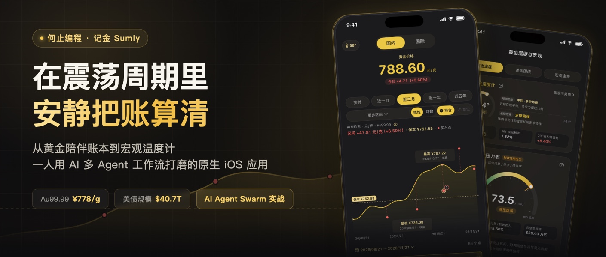
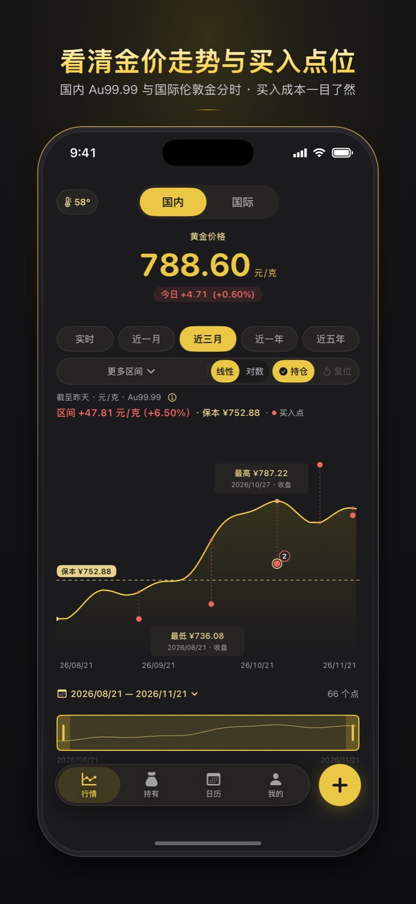
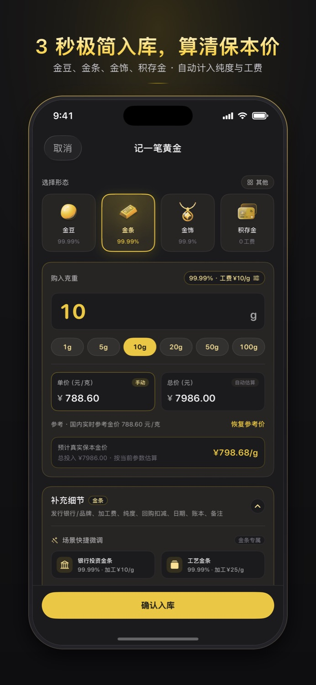
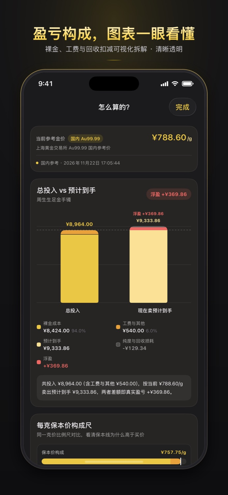
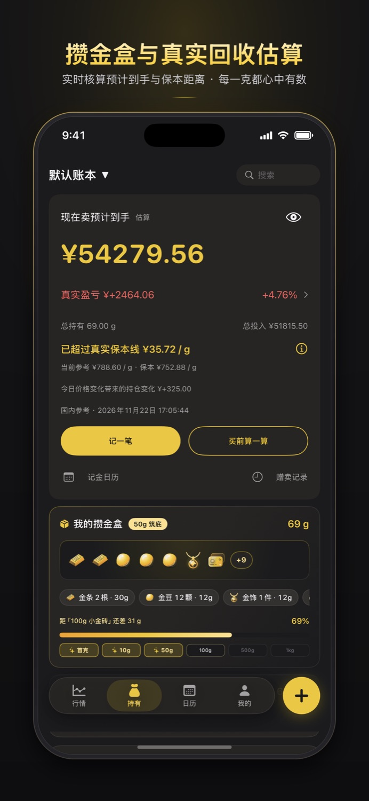
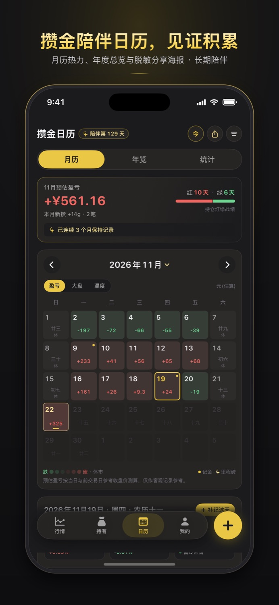
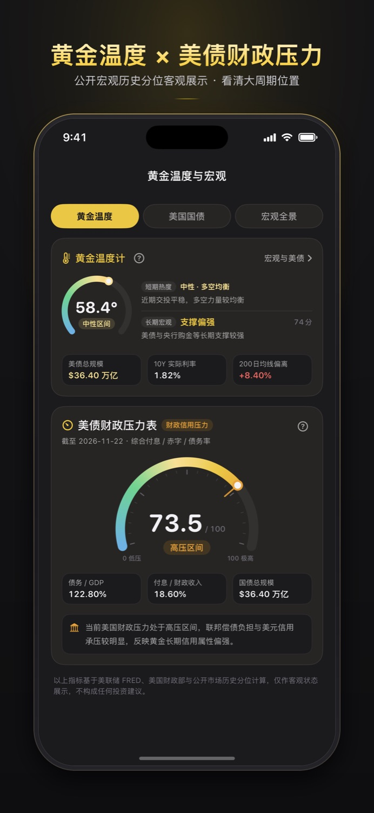

昨晚收工前顺手看了一眼盘面，国内 Au99.99 掉到了 **778 元/克** 附近。

前几个月金价冲上 1000 的时候，身边好几个平时从不碰理财的朋友，都在问金豆怎么买、银行积存金怎么开。这两周从高点回撤了快 20%，群里一下子清静了不少。

有个朋友前两天找我聊天，挺郁闷的。他说前阵子看新闻，美国国债总规模都已经突破 **40.71 万亿美元**，过去一年又多出 2.41 万亿，光每年还利息就要吃掉四分之一的联邦财政收入；按理说长期支撑没坏，可 10 年期实际利率还挂在 2.88%，自己刚买完就跌得这么狠，每天睡前刷一眼盘面，心里发慌。

这种感觉我太熟了，前两年我自己也是这样。

后来慢慢想通了一件事：买黄金最折磨人的，往往不是行情跌了多少，而是你明明打算拿三五年，却偏偏每天拿五分钟的分时图来拷打自己。

## 真正消耗人的，其实是笔糊涂账

普通人买黄金，账大多是很零散的。

不信你翻翻自己的记录：可能去年双十一顺手买了两颗金豆，过年给家里人买了一只带工费的古法手镯，发工资时在银行里攒过几笔积存金，路过金店又拎过一根小金条。涨的时候打开哪个 App 都开心，一跌下来想坐定算算到底亏了多少，翻完微信账单又翻电商订单和银行流水，越算越乱。

更扎心的是，你以为自己 800 买的、现在 778 一克也就亏 22 块，其实把当时每克二三十块的工费、首饰纯度，还有将来拿去回收要扣的折价全算进去，真正的保本金价往往比心里估的高出一截。

账算不清，心里就没底。心里没底，上午刷到一条说美债压顶黄金要破新高，下午又刷到一条说实际利率太高要腰斩，情绪被来回拉扯，最后干脆不敢打开看。

前阵子我索性把那些制造焦虑的财经推送全关了，利用下班后的晚上，给自己写了个挺安静的 iOS 小工具，叫 **「记金」**。

我没打算把它做成行情喊单软件，里面不预测涨跌，不弹焦虑弹窗，也绝不给任何买卖建议。我就想留一个干净的地方，把自己的持仓成本算明白，顺便看看大周期走到哪了。

对了，这个 App 从原生 iOS、Go 后端、七路行情和宏观数据管道，到配套的 React 后台，没有组建团队，是我一个人带着一套 AI 多智能体工作流一点点磨上 App Store 的。这部分放在文章后面细聊，先把工具本身带你看看。

## 把大盘走势，和自己的买点画在同一张图上

以前看金价，大盘曲线是大盘曲线，自己的订单是自己的订单，两边永远对不上号。

在「记金」首页里，除了看国内 Au99.99 和国际伦敦金的分时、切换线性或对数坐标回看多年走势外，只要点一下「持仓」，图上就会多出一条金色虚线——那是你全部持仓的**真实保本线**。你历史上的每一笔购入，都会变成一颗小红点落在大盘上，用一根很细的虚线连到当天的收盘价。

点开任意一颗红点，能直接看到那天花了多少钱、当天大盘是多少、算上工费以后你是较大盘多花了还是买划算了。同一天分几笔买的会自动聚合成一颗带角标的红点，点开就能看明细。哪怕是在周末休市或者盘中刚记下第一笔，红点也会先贴在曲线最右边，等下一个交易日收盘后自动归位。

把自己走过的脚印放回一两年的曲线里看，眼前的波动，很多时候就没那么吓人了。

## 三秒记一笔，顺便把隐形损耗摊开算

我自己很烦记账软件动不动填十几个字段，填完两次就不想打开了。所以我把入库做得很省事：选一下形态（金豆、金条、金饰、积存金），软件自动带出对应的常见纯度、工费和当前参考价，输完克重，底部直接算出这笔的预计真实保本价。

最能让人心里踏实的，其实是里面的「怎么算的？」页面。我没放一堆让人头大的代数公式，而是画了两根并排的对比柱：左边是你实际掏出去的钱里，多少是裸金本身、多少是工费和杂费；右边是按今天金价估算真拿去回收能到手多少钱，扣掉了多少纯度和折价，高出来的是浮盈，矮下去的是浮亏，一眼看透。

把最真实的底牌摊在阳光下算清了，焦虑其实就去了一大半。

## 少盯涨跌，多看积累

写这个工具写到一半，我自己用着有个挺有意思的变化：老盯着价格波动，人会变得急躁；但看着手里克重一点点变多，人反而会踏实下来。

所以在「持有」页里，我做了一个小小的「我的攒金盒」。你每记下一颗金豆、一根金条、一件金饰，盒子里就会多出一件小物件，陪着一路跨过首克、10g、50g、100g 这些节点。

旁边还配了一个「攒金陪伴日历」，按月历热力和 52 周总览把每一笔积累静静归档。想留个纪念发朋友圈的时候，一键开启脱敏模式就能隐藏具体金额，只记录坚持的天数和轨迹，不泄露财务隐私。

慢慢地，打开 App 的心情就变了。不再只是为了看今天涨了还是跌了，更像翻开一本自己的时间存折，看看自己不知不觉已经安安静静攒了多少天。

## 噪音之外，留两块客观的仪表盘

回到开头那个让人困惑的问题：为什么美债冲破 40 万亿，金价短期还能剧烈回调？

为了不再被各种情绪化观点带偏，我在「记金」里接了美联储 FRED、美国财政部、SPDR、CFTC 这些公开数据源，做了两块纯客观的仪表盘。一块叫黄金温度计，把短期市场热度（此刻偏冷，27.1°）和长期宏观背景（此刻偏强，66.9 分）拆开展示；另一块是美债财政压力表，把债务占 GDP、付息占财政收入和国债规模合到一张 0 到 100 的表盘里（当前 78.1 分）。

它不会告诉你现在该买还是该卖，只是把客观分位摆在面前，让你看清楚短期情绪和长期周期本来就经常错位。看懂了这层错位，冷的时候不容易乱，热的时候也不容易上头。

## 顺便聊聊：一个人怎么用 AI 把它磨上线的

身边好几个做技术、做产品的朋友体验完，都问过我同一件事：原生 Swift 6 / SwiftUI iOS 客户端、桌面和锁屏小组件、Go 后端加七路公开数据管道，外加一套 React + TypeScript 远程配置后台，这工作量怎么看都不像一个人业余时间能做完的。

说实话，确实只有我一个人。但我早就不用「开个聊天框问一段代码、复制粘贴」那种做法了。写 Demo 那样挺快，一进真实线上业务，上下文一长就开始改东坏西、根本上不了线。这次做「记金」，真正帮我跑通生产级交付的，其实是三个很朴素的工程习惯。

**第一，把活拆给多个 Agent 并行干，别全塞进一个对话里。** 我搭了一套多智能体协作（Swarm）的工作流，每次做新需求按端拆开——Go 后端、React 管理后台、iOS 客户端各自在隔离的 Git worktree 里同时改代码，互不踩脚。改完之后我也不听它口头汇报「改好了」，而是专门配一个独立的审校 Agent 去核对三端接口字段、跑通全量 **380 多条自动化测试**，再拉起真机分辨率的模拟器截屏逐页看样式，确认没问题才合回主干。

**第二，工程护栏比神级提示词重要得多。** 很多人花时间到处收藏万能 Prompt，但我踩过不少坑之后的体会是，真实项目里决定 AI 交付上限的不是提示词有多华丽，而是你有没有先铺好铁轨。动手写功能之前，我先把分层架构（Go Clean Architecture 架构依赖单测 + Swift 6 严格并发检查）、保本算法口径、非交易日等边界用例和合规检查，全写成了机器能自动校验的测试和仓库规范。有了这层护栏，AI 改错一行单测就过不去，交付质量一下就稳住了。

**第三，AI 负责扛执行，人把精力留给品味和细节。** AI 写代码再快，也替你感受不到普通人在金价连跌一周时的微妙情绪。像「买贵了不标刺眼的红字、改标平静的绿色多花」「用两根对比柱代替一屏干巴巴的公式」「周末刚买完的红点先挂在曲线最右端」这些细节，还是得靠人自己拿主意。区别只是，以前一个小团队排期两周才能验证完的一个想法，现在配合这套工作流，半小时就能把代码、单测和真机预览全跑出来看效果。

折腾完这一圈，我自己最大的体感是：AI 确实能把一个人的研发半径放大很多倍，但前提是你得懂工程拆分、懂验收标准，知道怎么用体系管住 AI 的输出，而不是把它当盲盒抽。

---

黄金从来不是让人暴富的东西，它更像普通人在不确定的时候，给自己存下的一块压舱石。市场热闹的时候它不说话，冷清的时候它也不说话。

我也希望「记金」能做到这样——不用注册账号就能在手机本地直接使用，随时可以一键藏起全部金额；如果以后换设备，也支持通过 Apple 登录把账本加密同步到云端，桌面和锁屏也配了小组件，抬眼就能看一眼金价和温度。

目前 iOS 版已经在 App Store 上架，直接搜索 **「记金」** 就能下载。

顺便跟一直看公众号的老朋友交个底：**现在 App 里的所有功能都是完全免费开放的。** 后面随着服务器、公开数据管道和持续迭代的成本上来，确实会考虑改成订阅制；但前期就算给关注公众号粉丝的一波专属福利——所有功能先敞开给大家免费用，建议大家趁现在赶紧下载、先薅一波羊毛。用着有任何觉得不顺手的地方，也可以直接提给我，趁免费期一起把它打磨得更顺手。

最后顺便在评论区聊两句吧。如果你也在攒金，可以留个言说说你手里第一克黄金是多少钱买的，现在回头看是什么心情；如果你正好也在琢磨 **AI 辅助研发提效、多 Agent 工作流落地**，或者手里有个产品想法，想了解怎么用 AI 低成本、高质量地从 0 到 1 做成正式上线的产品，欢迎留言交流，也可以直接在公众号后台回复 **「AI」**，我把这次做「记金」整理的实战工作流踩坑清单发给你，有需要也可以直接加微信约聊。

*免责说明：文中提及的金价、美债规模、实际利率与温度分位等数据均基于公开市场与宏观机构统计整理，仅供个人记录与客观观察参考，不构成任何投资、买卖或资产配置建议。市场有风险，决策请结合自身情况独立判断。*
